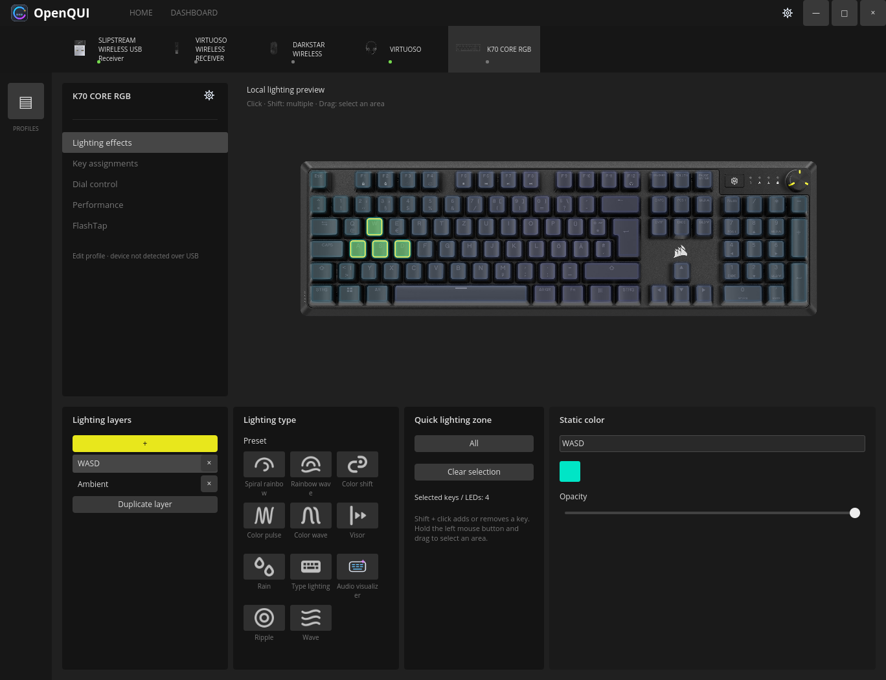
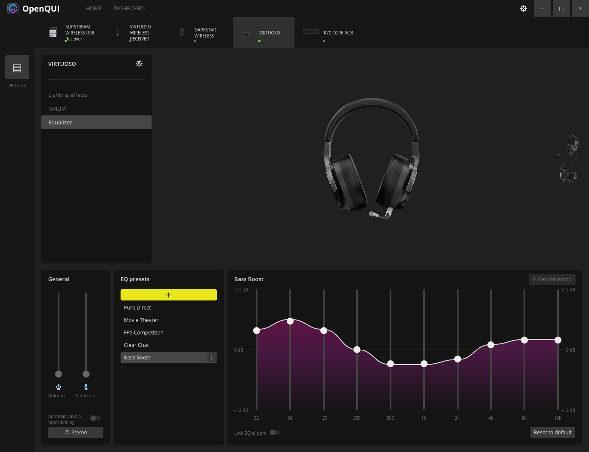

# OpenQUI

Native C++20 / Qt Quick application for Corsair peripherals on Linux.
The repository is `openQUI`; the executable is `open-cue-gui`.
English, German and Russian interfaces are included. Device names stay unchanged.

OpenQUI is an independent project with partial support for the K70 CORE RGB,
DARKSTAR WIRELESS and the tested VIRTUOSO receiver path. It does not yet replace
every feature of Windows iCUE.

## Features

- Live layered RGB editing and click, Shift or rectangle LED selection.
- K70 lighting that reacts to physical key presses.
- iCUE profile import and playback of supported layers across connected devices.
- Ten-band headset EQ and independent binaural 7.1 rendering through PipeWire.
- Battery queries and a system tray for the tested wireless device paths.
- [Supported device list](docs/supported-devices.md).
- [Lighting and DPI](docs/features.md).
- [Profiles and import limits](docs/profiles.md).
- [Audio and other feature status](docs/compatibility.md#capabilities).
- [Linux compatibility](docs/compatibility.md#linux-build-contract).
- [Documentation](docs/README.md).

## Info

- This project was created out of necessity to control Corsair peripherals on workstations after switching to Linux.
- Use this software at your own risk. It is provided without warranties; the authors disclaim liability to the extent permitted by applicable law. See the [MIT license](LICENSE).
- The devices listed as partially supported have been exercised on live hardware. Individual features still have separate testing limits; see [validation](docs/validation.md).
- Take care and have fun!
- This project is not an official Corsair product.

## Build and run

Requires Linux, a C++20 compiler, CMake 3.24+, Ninja, Qt 6.8+ including QML
modules, libudev and ALSA development packages. PipeWire command-line tools are
needed for headset processing. Python 3 is used only by maintenance/test tools;
the application is native C++.

```sh
cmake --preset native
cmake --build --preset native --parallel 2
ctest --preset native
./build/native/open-cue-gui
```

[Getting started](docs/getting-started.md) includes Fedora and Debian packages,
Docker builds, user installation, HID permissions and isolated UI preview.
For VS Code, use the [Russian setup and troubleshooting guide](docs/vscode-guide.ru.md),
the repository's Dev Container and the supplied Build/Test tasks.
Fedora 44 and Debian 13 source builds are exercised locally. Other distributions
need the same dependencies and their own validation. A Fedora executable is not
an all-distribution binary; AppImage/Flatpak packages are not provided yet.

## Contributing

Start with [CONTRIBUTING.md](CONTRIBUTING.md), then use:

- [Development and code style](docs/development.md): source map, QML editing, C++ formatting and translations.
- [Testing](docs/testing.md): deterministic contracts, private PipeWire tests and physical acceptance.
- [Architecture](docs/architecture.md): ownership, persistence, hardware and audio boundaries.
- [Validation](docs/validation.md): tested platforms, presets and acceptance boundaries.
- [Adding devices](docs/adding-devices.md): metadata, transport evidence, fixtures and support gates.
- [Supported devices](docs/supported-devices.md): available models, exact connections and limitations.
- [Corsair device backlog](docs/corsair-device-backlog.md): sourced product lists and pending Linux support.
- [Assets](docs/assets.md): importing optional resource packages and keeping provenance.
- [Profiles](docs/profiles.md): official library, sidebar behavior and import limits.

Hardware reports should include model, VID:PID, firmware, connection type,
HID descriptor and observed result. Do not include pairing keys or personal
profiles. Unsupported devices must remain unavailable for writes until their
protocol is verified.

## Screenshots and resources



*K70 CORE RGB: original device rendering, separate WASD and ambient lighting layers.*



*VIRTUOSO: original device rendering and the ten-band Bass Boost preset.*

These captures use the local original-resource build in isolated preview, with
no device writes. The default build uses original images when the required local
bundles exist; a clean source checkout uses authored fallback drawings. See
[assets](docs/assets.md) for importing resources and [the inventory](docs/asset-catalog.json)
for the supplied packages. Images do not establish device support.

## Related projects

[OpenLinkHub](https://github.com/jurkovic-nikola/OpenLinkHub) inspired the README
navigation and separate supported-device page. Its Go service is not an OpenQUI
dependency. [Developer notes](docs/development.md#native-corsair-device-support)
describe independently implemented C++ device support and the direct HID path.

## License

Authored source, QML, tests, translations and SVG drawings are available under
[MIT](LICENSE), including its warranty disclaimer and limitation of liability.
Mandatory law can limit those exclusions; the license does not guarantee complete
immunity from liability. Dependencies and the KEMAR measurements have their own notices
in [THIRD_PARTY_NOTICES.md](THIRD_PARTY_NOTICES.md). Locally imported iCUE assets
are not relicensed by this repository's MIT license. Corsair and iCUE are
trademarks of their owners; this project is not affiliated with Corsair.
