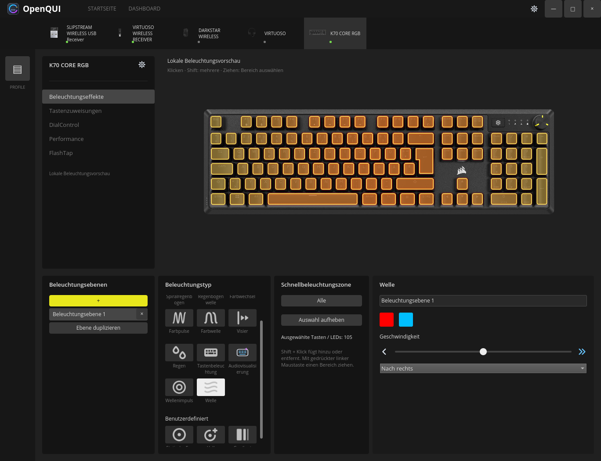
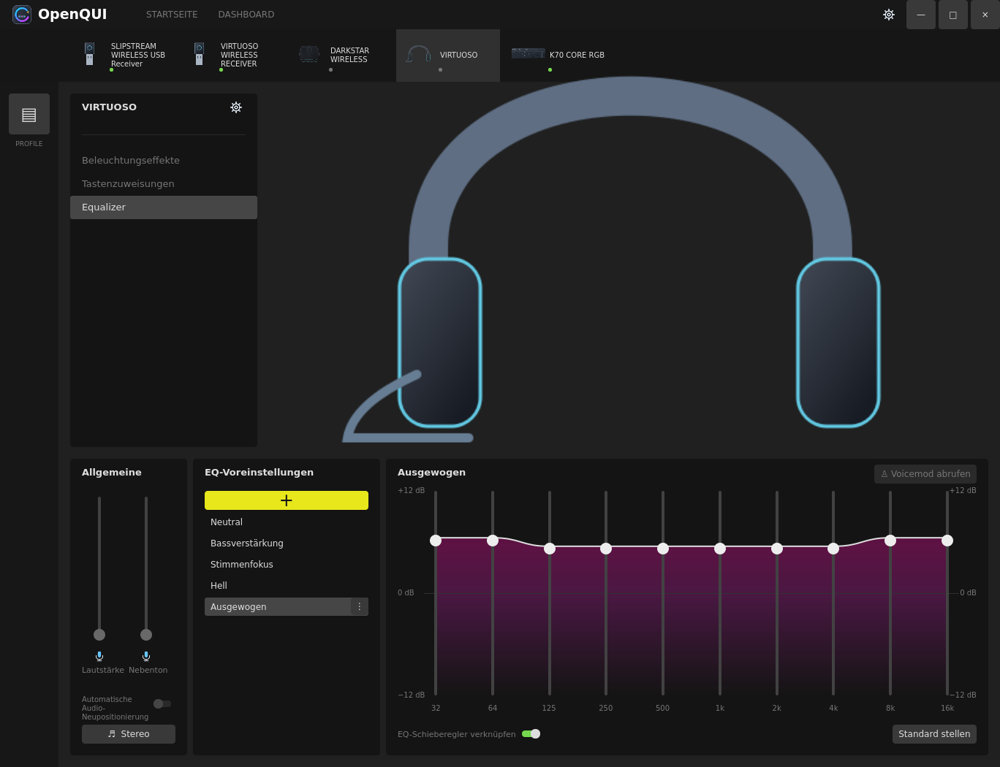

# OpenQUI

Native C++20 / Qt Quick application for Corsair peripherals on Linux.
The repository is `openQUI`; the executable is `open-cue-gui`.
English, German and Russian interfaces are included. Device names stay unchanged.

OpenQUI provides live layered RGB editing, click/Shift/rectangle LED selection,
iCUE profile import, headset EQ and a Linux binaural 7.1 renderer. It is an
independent project with a deliberately small, verified hardware implementation.
It does not yet replace every feature of Windows iCUE.




## Hardware support

| Device | Tested connection | Available hardware implementation |
| --- | --- | --- |
| K70 CORE RGB | USB `1b1c:1bfd` | Per-key RGB; Type effect driven by verified keyboard input reports |
| DARKSTAR WIRELESS | USB `1b1c:1bb2`; linked child of receiver `1b1c:1bdc` | RGB, battery and radio status; guarded wired active-DPI and pairing transactions |
| VIRTUOSO | Headset through receiver `1b1c:0a42` | RGB, battery, receiver-specific audio routing, ten-band EQ and binaural 7.1 |

There are **three peripheral implementations and two receiver UI entries**.
The [Corsair device backlog](docs/corsair-device-backlog.md) lists the wider
product inventory and the models whose Linux implementation is still pending.
Only the VIRTUOSO command path through `0a42` has headset hardware evidence.
Other VIRTUOSO variants, HS-series headsets and other Corsair keyboards/mice are
not assumed compatible. DPI response validation and pairing readback are
implemented; physical DPI measurement and pairing after cable removal remain
separate acceptance checks. Fifteen mouse assignments and F1–F24 exist in the
editor; global key replay, macros and hardware assignment upload are unfinished.

See [the full support matrix](docs/compatibility.md) for features and USB-ID
boundaries, and [adding a device](docs/adding-devices.md) for the contribution path.

## Build and run

Requires Linux, a C++20 compiler, CMake 3.24+, Ninja, Qt 6.8+ including QML
modules, libudev and ALSA development packages. PipeWire command-line tools are
needed for headset processing. Python 3 is used only by maintenance/test tools;
the application is native C++.

```sh
cmake --preset native
cmake --build --preset native --parallel 2
ctest --preset native
./build/native/open-cue-gui
```

[Getting started](docs/getting-started.md) includes Fedora and Debian packages,
Docker builds, user installation, HID permissions and isolated UI preview.
For VS Code, use the [Russian setup and troubleshooting guide](docs/vscode-guide.ru.md),
the repository's Dev Container and the supplied Build/Test tasks.
Fedora 44 and Debian 13 source builds are exercised locally. Other distributions
need the same dependencies and their own validation. A Fedora executable is not
an all-distribution binary; AppImage/Flatpak packages are not provided yet.

## Profiles

[Profiles/](Profiles/README.md) contains a sourced catalog and downloader for
the official Corsair gallery; the local snapshot has 82 original profiles.
The sidebar adds profiles below the list and offers right-click operations.
Import converts supported layers for each known device and preserves the
complete source XML. [Conversion and playback limits](docs/profiles.md)
describe the effects and hardware behavior that still need implementation.

## Resources and screenshots

The default build automatically uses original iCUE device renderings when the
required local bundles are present. The `local-assets` preset requires them
explicitly; `source-only` selects authored fallback drawings. Without local
bundles a clean source checkout uses the fallback. HID support does not depend
on the pictures. Local imports are excluded from Git without deleting them.

The [asset importer](docs/assets.md) reads **every available package** in a
supplied installation. The audited iCUE 5.52.93 snapshot contains five Corsair
device bundles and three partner-integration bundles, plus shared images,
fonts and icons. It is not the full Corsair product catalog. Importing another
model's images does not implement its driver. The [asset catalog](docs/asset-catalog.json)
records the actual inventory. Original views in this snapshot are raster
renders and masks; no GLB, FBX or OBJ model was found.

The two README images show original K70 CORE and VIRTUOSO renderings from the
locally supplied iCUE snapshot in isolated preview, with no real device writes.
The Corsair renderings are not covered by the source code's MIT license.
Historical diagnostic
screenshots, Windows binaries, private profiles and pairing journals are not
part of the source repository.

## Contributing

Start with [CONTRIBUTING.md](CONTRIBUTING.md), then use:

- [Development and code style](docs/development.md): source map, QML editing, C++ formatting and translations.
- [Testing](docs/testing.md): deterministic contracts, private PipeWire tests and physical acceptance.
- [Architecture](docs/architecture.md): ownership, persistence, hardware and audio boundaries.
- [Validation](docs/validation.md): tested platforms, presets and acceptance boundaries.
- [Adding devices](docs/adding-devices.md): metadata, transport evidence, fixtures and support gates.
- [Corsair device backlog](docs/corsair-device-backlog.md): sourced product lists and pending Linux support.
- [Assets](docs/assets.md): importing optional resource packages and keeping provenance.
- [Profiles](docs/profiles.md): official library, sidebar behavior and import limits.

Hardware reports should include model, VID:PID, firmware, connection type,
HID descriptor and observed result. Do not include pairing keys or personal
profiles. Unsupported devices must remain unavailable for writes until their
protocol is verified.

## License

Authored source, QML, tests, translations and SVG drawings are available under
[MIT](LICENSE). Dependencies and the KEMAR measurements have their own notices
in [THIRD_PARTY_NOTICES.md](THIRD_PARTY_NOTICES.md). Locally imported iCUE assets
are not relicensed by this repository's MIT license. Corsair and iCUE are
trademarks of their owners; this project is not affiliated with Corsair.
